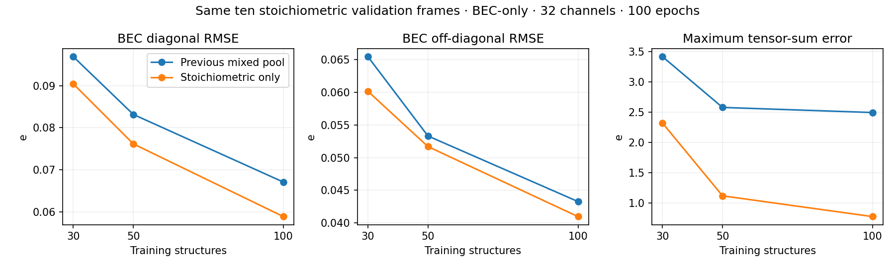

# Stoichiometric ZrO₂ teaching dataset comparison

The stoichiometric subset improves BEC validation errors and reduces tensor-sum errors in these bounded fits. Residuals remain appreciable: chemical filtering does not impose a sum constraint on the model. The introductory notebooks continue to show RMSE, parity and checkpoint reuse; these diagnostics stay in this separate developer study.

## Dataset and protocol

The official 10,103-frame source has 3,977 stoichiometric frames: 1,999 O₃₂Zr₁₆ cells (48 atoms) and 1,978 O₆₄Zr₃₂ cells (96 atoms). The 6,126 oxygen-vacancy frames are excluded by atom counts. Both stoichiometric cell sizes are retained. No labels, reference sums or model errors determine membership, and no label/prediction correction is applied.

The saved 240-frame pool has 200 balanced, interleaved training candidates and fixed 20/20 validation/test sets. The prior mixed-pool stoichiometric holdouts are retained (ten in each partition), and additional holdouts exclude the previous pool. The generator reproduces the pool and manifest byte-for-byte from the checksum-matched official XYZ. E/F/S/BEC round trips and geometry screening pass. See [attribution and data policy](../../example_inputs/tutorial_polar/DATA.md). Trajectory independence is unknown.

All fits use lmax=2, four layers, batch size four, cutoff 6 Å, seed 42, float32, Adam at initial learning rate 0.005 and epoch-wise decay 0.992. Best checkpoints minimize validation weighted total loss. Configuration-comparison fits predict only training and validation. Separate one-epoch CPU notebook smoke tests exercise all-partition inference/parity for plumbing; their accuracy is not used for configuration selection. No full-dataset training was performed. Native monitoring leaves training objectives and model outputs unchanged.

## Shared-validation comparison

These BEC-only, 32-channel, 100-epoch fits are evaluated on the **same ten stoichiometric validation structures**. Previous mixed-pool checkpoints are reloaded, without retraining; new checkpoints are independently reloaded through ASE. Both analyses use original reference labels and float64 tensor sums. The previous models trained on mixed compositions, while the new models train only on stoichiometric frames. Training IDs and software environments also differ, so this is a useful teaching comparison rather than an isolated causal estimate of the effect of vacancies.

| Training count | Pool | Diagonal RMSE (e) | Off-diagonal RMSE (e) | Maximum / median sum error (e) |
|---:|---|---:|---:|---:|
| 30 | Mixed | 0.09689 | 0.06543 | 3.41672 / 1.33457 |
| 30 | Stoichiometric | 0.09042 | 0.06014 | 2.31934 / 0.76525 |
| 50 | Mixed | 0.08315 | 0.05331 | 2.57715 / 1.06052 |
| 50 | Stoichiometric | 0.07614 | 0.05168 | 1.11633 / 0.62657 |
| 100 | Mixed | 0.06706 | 0.04328 | 2.49297 / 1.45269 |
| 100 | Stoichiometric | 0.05885 | 0.04098 | 0.77268 / 0.41282 |



## All twenty validation structures

| Task / channels | Training count | Epoch budget / best | Diagonal / off-diagonal RMSE (e) | Maximum / median sum error (e) | Training wall time on Mosso |
|---|---:|---:|---:|---:|---:|
| BEC / 16 | 50 | 100 / 100 | 0.08819 / 0.05640 | 2.27555 / 0.80211 | 202.2 s |
| BEC / 16 | 50 | 200 / 200 | 0.07639 / 0.04906 | 1.58371 / 0.54355 | 383.5 s |
| BEC / 32 | 30 | 100 / 100 | 0.09047 / 0.05997 | 2.39862 / 0.95398 | 128.2 s |
| BEC / 32 | 50 | 100 / 99 | 0.07600 / 0.05106 | 1.48533 / 0.63645 | 214.2 s |
| BEC / 32 | 50 | 200 / 197 | 0.06568 / 0.04466 | 1.17698 / 0.49704 | 396.5 s |
| BEC / 32 | 100 | 100 / 100 | 0.05879 / 0.04007 | 0.91535 / 0.47318 | 354.4 s |
| Multitask / 32 (FlashTP) | 50 | 100 / 99 | 0.08026 / 0.04999 | 1.40337 / 0.53714 | 150.2 s |
| Multitask / 32 (FlashTP) | 50 | 200 / 198 | 0.06638 / 0.04313 | 1.30139 / 0.58417 | 272.3 s |

Mosso used A100-80GB PCIe or A800-40GB GPUs, Python 3.10.20, PyTorch 2.5.1, e3nn 0.6.0, ASE 3.28.0 and two CPU threads. Exact GPU, source revision, configuration, split and timing are retained per run. Different GPUs prevent interpreting wall-time differences as a pure backend speedup. The installed FlashTP extension is flashTP_e3nn 0.1.0; its same-checkpoint E/F/S/BEC, weighted-loss and all 29 parameter-gradient checks pass for both multitask budgets. This is distinct from the source-pinned Colab build.

Doubling the 50-frame epoch budget improves component RMSE, with a smaller and inconsistent effect on worst-case tensor sums. The 100-frame / 100-epoch BEC fit gives the smallest maximum sum error among these configurations. These runs differ in optimizer updates and epoch-based learning-rate schedules. They are one-seed observations, and do not reproduce the approximately 0.03 e residual reported for a separate full-data model.

Full-precision reference sums are at most 1×10⁻⁷ e in this pool. CLI CSV references are rounded and can sum to about 3×10⁻⁶ e; the independent ASE tables above use original labels. The meaningful residual is the maximum component of the prediction-minus-reference tensor sum, computed before taking its absolute maximum.

## T4 budget check

The validation-only standard-e3nn **50-frame / 32-channel / 100-epoch T4 run completed**: training subprocess wall time **687.2 s (11.5 minutes)** and separate CLI inference **15.0 s**. Validation BEC RMSE is **0.07600 / 0.05106 e**, agreeing with the Mosso result within 2×10⁻⁶. Maximum / median sum errors are approximately **1.485 / 0.636 e**. The best checkpoint is epoch 99. Independent ASE checkpoint reload agrees with CLI predictions on a validation structure, and the checkpoint ZIP passes archive-integrity checks. No test predictions enter this comparison.

PyTorch training peaks were **3.76 GiB allocated / 9.83 GiB reserved**, with float32 and two CPU threads. Colab used Python 3.13.15, PyTorch 2.11.0+cu130, e3nn 0.6.0 and ASE 3.29.0. This run reused the environment installed during the initial trial; installation is excluded from the training time. The initial fresh fetch/install took 5.5 / 12.7 s. The exact source commit and environment remain in the [T4 report](results/stoichiometric_zro2/t4_bec32_50_e100/report.json).

The exploratory 200-epoch T4 run was stopped after its epoch timing indicated that it would exceed the tutorial budget. Its partial timing is not reported as a completed run; all 200-epoch Mosso runs completed. The tutorial-sized choice is **50 training structures, 32 channels, four layers, batch four and 100 epochs**. A larger 100-frame fit improves validation and sum errors, with additional training cost. The 0.9–1.5 e worst-case residuals remain far above a high-accuracy full-data fit, so this is an RMSE teaching example rather than evidence of quantitatively accurate sum-rule behavior.

## Reproduce or use the alternative

The validated Li₃PO₄ defaults remain unchanged. To try the restricted ZrO₂ task in either notebook, set `DATASET='zro2_stoichiometric'`, `TRAINING_STRUCTURES=50`, `CHANNELS=32`, and `EPOCHS=100`. The data and epoch controls also have environment overrides; channels can be edited in the configuration cell. Select a GPU for the full fit. The optional LAMMPS cell currently demonstrates Li₃PO₄ and remains disabled for this ZrO₂ selection.

For validation-only screening with a fresh output directory:

```bash
python tutorials/colab/subset_experiment.py --dataset zro2_stoichiometric --sizes 30 50 100 --epochs 100 --channels 32 --layers 4 --batch-size 4 --output /tmp/polar-stoichiometric-zro2
```

Use `--multitask --flash` only with a compatible installed CUDA extension; otherwise standard e3nn works. The [compact records](results/stoichiometric_zro2) include full-precision validation audits, common-frame comparisons, configurations, native convergence CSVs, monitoring diagnostics and runtime profiles. Full best-checkpoint archives are retained during development and generated by the harness.

Both notebooks also complete one-epoch CPU smoke runs using the restricted pool, with zero cell errors. These smoke runs verify execution and label handling; their accuracy is excluded from configuration comparisons. The notebook defaults remain Li₃PO₄, and the benchmark does not establish a full 100-epoch CPU run or a source-pinned FlashTP Colab run for this new material.
