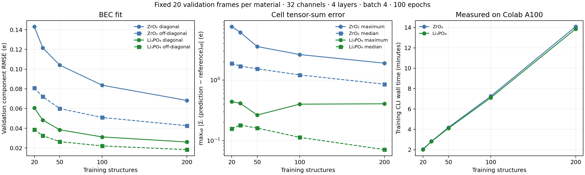

# Bounded dataset and tensor-sum study

The tutorials now use **50 training + 20 validation + 20 test structures from Li₃PO₄**, four convolutional layers, lmax=2, batch size 4 and 100 epochs. The quickstart uses 16 channels; multitask uses 32 on CUDA and 16 on CPU. ZrO₂ remains available as an alternative. No full dataset was trained for this study.

The selection was driven by validation behavior and the tutorial runtime budget. It reduces the large cell-wide tensor-sum errors seen in the original 30-frame ZrO₂ exercise, without imposing an ASR correction or changing the native objective. These remain small educational fits; they do not establish production accuracy or reproduce the approximately 0.03 e residual reported for a separate full-data model.

## What is measured

For each cell, let `S_pred = Σᵢ Z*_pred,i` and `S_ref = Σᵢ Z*_ref,i`.

- **Raw sum:** `max_ab |S_pred,ab|`, in e. For neutral cells this is the usual ASR diagnostic.
- **Reference sum:** `max_ab |S_ref,ab|`, in e.
- **Tensor-sum error:** `max_ab |S_pred,ab − S_ref,ab|`, in e. Subtract tensors before taking maxima; subtracting two reported scalar maxima is incorrect.

Partition maxima and medians aggregate these per-cell values. They are not normalized by atom count. `asr.csv` also saves atom-normalized values, composition and original source IDs. Native `ASRMean`/`ASRMax` epoch metrics report raw predicted sums, with validation-reference baselines in the convergence plots. Monitoring does not alter predictions, training loss or best-checkpoint selection.

Li₁₁O₁₆P₄ labels have a reference sum near **1 e per cell**. The dataset author considers a charged-cell DFPT convention the likely explanation; the original DFPT settings have not been independently verified. These frames and labels are retained unchanged. Li₁₂O₁₆P₄ and Li₂₂O₃₁P₈ reference sums are much closer to zero, though not exact. The fixed Li validation maximum is **1.0266 e**. A raw prediction maximum near 1 e therefore does not mean a 1 e model error. Inspect errors and compositions together.

## Controlled size sweep

Both input files matched their official Zenodo checksums. Each bounded pool contains a composition-balanced, label-independent reservoir of 200 training structures plus fixed 20 validation and 20 test structures. The training subsets are nested prefixes of 20/30/50/100/200. Geometry fingerprint screening found no duplicate geometries across the selected pool, and E/F/S/BEC serialization checks passed. Original source IDs and checksums are in the [pool manifests](../../example_inputs/tutorial_polar/DATA.md).

Each size starts from fresh weights with model seed 42, 32 channels, four layers, lmax=2, cutoff 6 Å, batch size 4, 100 epochs, Adam learning rate 0.005 and exponential decay 0.992. Only BEC loss is weighted in the screening runs. Production CLI defaults and normalization are preserved; the current CLI still computes energy/force derivatives with zero energy/force weights. Times include CLI startup, graph preparation, optimization and checkpoint writing, but exclude installation and evaluation.

The checkpoint minimizes validation weighted total loss. Test predictions were not used in the sweep or the Mosso configuration comparisons. Epoch counts give different optimizer-update counts across dataset sizes: 500, 800, 1300, 2500 and 5000 updates at epoch 100. This is a practical fixed-epoch tutorial comparison, not an equal-update data-efficiency experiment.

| Material | Train | Validation diagonal / off-diagonal RMSE (e) | Raw sum max (e) | Tensor-sum error max / median (e) | A100 training (min) |
|---|---:|---:|---:|---:|---:|
| ZrO₂ | 20 | 0.1431 / 0.0808 | 7.599 | 7.599 / 1.877 | 2.04 |
| ZrO₂ | 30 | 0.1215 / 0.0721 | 6.122 | 6.122 / 1.697 | 2.82 |
| ZrO₂ | 50 | 0.1041 / 0.0600 | 3.569 | 3.569 / 1.533 | 4.18 |
| ZrO₂ | 100 | 0.0837 / 0.0509 | 2.634 | 2.634 / 1.216 | 7.26 |
| ZrO₂ | 200 | 0.0682 / 0.0426 | 1.898 | 1.898 / 0.855 | 14.09 |
| Li₃PO₄ | 20 | 0.0607 / 0.0387 | 1.145 | 0.443 / 0.158 | 2.00 |
| Li₃PO₄ | 30 | 0.0484 / 0.0324 | 1.139 | 0.413 / 0.181 | 2.80 |
| Li₃PO₄ | 50 | 0.0385 / 0.0265 | 1.112 | 0.265 / 0.161 | 4.10 |
| Li₃PO₄ | 100 | 0.0312 / 0.0221 | 1.071 | 0.400 / 0.114 | 7.10 |
| Li₃PO₄ | 200 | 0.0261 / 0.0183 | 1.094 | 0.406 / 0.071 | 13.86 |

ZrO₂ validation reference sums are at most 8e-8 e, so raw sum and tensor-sum error agree to the displayed precision. Larger Li subsets improve component RMSE and typical sum errors, but the maximum is not monotonic. Fifty training frames give a useful compromise without the runtime cost of 100–200. That observation does not rule out better ZrO₂ settings or predict another seed's worst-case error.

The screening runtime was Colab A100-SXM4-40GB, Python 3.13.15, PyTorch 2.11.0+cu130, e3nn 0.6.0 and ASE 3.29.0, float32 with two CPU threads. Exact source revision `a8018ed65aaa4535c2a17ac429c9e63bbfc79680`, configurations, environment, checkpoint epochs, source IDs and per-frame sum tensors are retained in [machine-readable reports](results/subset_study). The final notebooks additionally enable native ASR monitoring introduced on the refinement branch.

## Configuration checks on Mosso

Three Slurm jobs trained the same 50-frame Li subset for 100 epochs with fixed validation frames. All completed with exit code zero and appended the required machine ledger entries. Their test sets were not evaluated.

| Mode | GPU | Train time (s) | Validation BEC diagonal / off-diagonal RMSE (e) | Tensor-sum error max / median (e) |
|---|---|---:|---:|---:|
| BEC-only, 16 channels, e3nn | A100 80GB PCIe | 200.2 | 0.0388 / 0.0268 | 0.425 / 0.120 |
| E/F/S/BEC, 32 channels, e3nn | A800 40GB | 203.2 | 0.0543 / 0.0357 | 0.351 / 0.242 |
| E/F/S/BEC, 32 channels, FlashTP | A100 80GB PCIe | 143.0 | 0.0543 / 0.0357 | 0.351 / 0.242 |

Different GPUs prevent interpreting the latter two wall times as a pure backend speedup. The FlashTP job did compare the same checkpoint and batch of four on the same GPU: median forward time **37.58 / 29.15 ms** and forward-plus-backward **109.27 / 74.67 ms** for e3nn/FlashTP. Ten synchronized samples followed three warmups. Both models were resident, so microbenchmark memory is process-wide. All E/F/S/BEC outputs, weighted loss and **29 parameter gradients** passed numerical agreement checks; maximum gradient absolute difference was 2.72e-7. The installed extension was `flashTP_e3nn` 0.1.0; no compilation time is included. This auxiliary installed backend is distinct from the notebook's source-pinned Colab build.

Mosso used Python 3.10.20, PyTorch 2.5.1, e3nn 0.6.0 and ASE 3.28.0. Clean source revisions were `edaee9b` for standard runs and `001f8ab` for the installed-FlashTP harness. Full metadata and validation artifacts are under `results/subset_study/mosso_*`.

## Reproduction and limits

Use [the validation-only harness](subset_experiment.py) with a new output directory for each configuration. `--multitask --flash --channels 32` uses an already-installed CUDA FlashTP extension and checks numerical/gradient agreement; it does not install or pin that extension. The notebook performs its own pinned optional build instead.

These are single-seed runs on composition-balanced whole-structure splits. Unknown trajectory correlations remain a limitation despite duplicate screening. Charged-cell conventions, atom counts and composition affect raw sums. BEC component RMSE, raw sums, tensor-sum errors and E/F/S errors answer different questions; retain all of them when refining the tutorial. No sum-rule projection, zero-sum relabeling, dielectric training or full-dataset training was performed.
